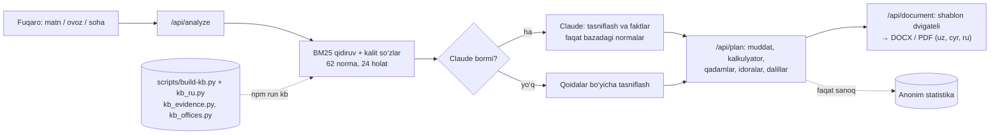

# HuquqYo‘l — huquqingiz buzilganda: qonun, yo‘l va tayyor ariza

[](https://github.com/GiyosjonJumayev/huquqyol/actions/workflows/ci.yml)

%20%C2%B7%20rus-0e6b5c)

[](LICENSE)

> Fuqaro muammosini o‘z so‘zi bilan yozadi yoki **hujjat rasmini yuklaydi** — bir daqiqada **qaysi qonun himoya qilishi**, **necha kun qolgani**, **qayerga borish** va **qaysi dalillarni yig‘ish** kerakligini biladi va **tayyor arizani** Word yoki PDF qilib oladi.


## Muammo

Huquqi buzilgan fuqaro uch narsani bilmaydi: qaysi qonun himoya qiladi, qayerga borish kerak va muddat qachon tugaydi. Yurist xizmati qimmat, ariza yozish qo‘rqinchli — natijada odamlar kutib qoladi yoki muddatni o‘tkazib yuboradi. Eng ko‘p zarar ko‘radiganlar: keksalar, qishloq aholisi va xorijdagi mehnat migrantlari.

## Yechim

| 1. Vaziyat | 2. Reja | 3. Ariza |
|---|---|---|
| O‘z so‘zi bilan yozadi yoki aytadi (o‘zbekcha lotin/kirill, ruscha) yoki sohani tanlaydi | Qonun moddasi (lex.uz havolasi), muddat va xavf, kalkulyator, qadamlar, **qayerga borish** (rasmiy manzil va telefon), **dalillar ro‘yxati** | Tayyor talabnoma, ariza, shikoyat yoki da’vo — ish beruvchi, inspeksiya, idora yoki sudga; DOCX, PDF, chop etish |

**Nimasi bilan ajralib turadi**

- **Qonunni AI o‘ylab topmaydi.** 62 ta norma va 14 ta idora ma’lumoti rasmiy manbalardan qo‘lda tekshirilgan, har birida manba bor. AI faqat tasniflaydi; muddat, summa va ariza matni — tekshirilgan formula va shablonlar. AI ishlamasa ham ilova to‘liq ishlaydi.
- **Muddat qonun bo‘yicha hisoblanadi** (MK 9-modda: oy oxiri; yakshanba yoki bayram kuni → keyingi ish kuni). Bayramlar ro‘yxati — `server/holidays.js`; Ramazon va Qurbon hayiti sanalari har yili rasmiy e’londan keyin qo‘shiladi (yoki `HOLIDAYS_EXTRA`).
- **Keksalar uchun:** 4 darajali katta shrift va matnlarni ovozli o‘qish.
- **Maxfiylik:** ariza ma’lumotlari faqat qurilmada; anonim statistika faqat sanoq — matn, IP, cookie saqlanmaydi.
- **Internetsiz ishlaydi** (PWA): shriftlar, bilim bazasi va hujjat generatori loyiha ichida.

## Raqamlarda

| Sohalar / holatlar | Normalar | Hujjat shablonlari | Dalillar | Idoralar | Kalkulyatorlar | Testlar |
|---|---|---|---|---|---|---|
| 12 / 24 | 62 (55 tasi modda raqami bilan) | 63 × 3 til = 189 | 123 | 14 | 5 | 101 unit + 10 brauzer |

## Ko‘rinishlar

| | |
|---|---|
|  Bosh sahifa: vaziyatni yozish yoki 12 sohadan birini tanlash |  Qadamlar va «Qayerga murojaat qilish» — rasmiy manzil, telefon, manba |
|  Ariza siz yozgan sari to‘ladi; kimga yozish bir bosishda almashadi |  Qulaylik: shrift o‘lchami va ovozli o‘qish |
|  Telefon, qorong‘i mavzu |  Anonim statistika (rasmda **namunaviy** sanoqlar) |

## Arxitektura



Backend — Node.js + Express (holatsiz), frontend — freymvorksiz ES modullar, server tomonida oldindan chiziladi. Bilim bazasi — Python generator: ikki tilning mosligini, shablon kalitlarini, dalillar sonini va idoralar manbasini tekshiradi.

## 1 daqiqada ishga tushirish

```bash
npm ci
npm start            # http://localhost:3000 — AI kalitisiz ham to‘liq ishlaydi
```

Taqdimot ssenariysi, zaxira reja va hakamlar savollariga javoblar — [DEMO.md](DEMO.md). Hostingga joylashtirish (cPanel, VPS, Docker, Render) — [DEPLOY.md](DEPLOY.md). Xavfsizlik va maxfiylik — [SECURITY.md](SECURITY.md). O‘zgarishlar tarixi — [CHANGELOG.md](CHANGELOG.md).

## Yo‘l xaritasi

- my.sud.uz va my.gov.uz orqali arizani to‘g‘ridan-to‘g‘ri topshirish;
- ko‘p sahifali hujjatlar va PDF fayldan o‘qish (bitta rasmdan o‘qish 3.12 da qo‘shildi);
- Telegram bot (migrantlar uchun eng qulay kanal);
- qoraqalpoq tili;
- yuridik klinikalar va advokatlar bilan hamkorlik: murakkab ishni bir bosishda yuristga yo‘naltirish;
- yangi sohalar: anonim statistikadagi «doiradan tashqari» so‘rovlar asosida.

## Imkoniyatlar

Fuqaro muammosini oddiy tilda yozadi yoki sohani tanlaydi. Tizim vaziyatni tahlil qiladi va quyidagilarni beradi: tegishli qonun normalari (lex.uz havolasi bilan), qadamma-qadam reja, muddat va xavf bahosi, kalkulyator, hamda tayyor ariza. Ariza DOCX, PDF yoki chop etish uchun tayyor holatda chiqadi.

**Uch tilda ishlaydi:** o‘zbek (lotin), o‘zbek (kirill) va rus. Til interfeys, normalar matni, qadamlar, kalkulyatorlar, xato xabarlari va tayyor arizaga birdek tatbiq etiladi. Rus tilidagi ariza ruscha rasmiy uslubda yoziladi («ИСКОВОЕ ЗАЯВЛЕНИЕ», «На основании изложенного прошу:»). Vaziyatni istalgan tilda yozish mumkin, jumladan o‘zbekcha kirillda.

**Hujjat rasmidan o‘qish (AI yoqilganda).** «Rasmdan» tugmasi bilan jarima qarori, chek, ish beruvchi buyrug‘i, bank xabarnomasi yoki kommunal hisob rasmini tanlash mumkin. Claude rasmda ko‘rinib turgan faktlarni ajratadi: hujjat turi, kim chiqargani, raqami, sanasi, summasi, avtomobil raqami. So‘ng holat odatdagi tahlil orqali aniqlanadi, muddat hujjat sanasidan **kodda** hisoblanadi («Shikoyat berish uchun 7 kun qoldi»), ariza maydonlari o‘zi to‘ladi. Rejada «Hujjatdan o‘qildi» kartasi chiqadi — fuqaro uni asl hujjat bilan solishtiradi. Rasm brauzerda 1600 px gacha kichraytiriladi, serverda saqlanmaydi va logga yozilmaydi.

Vaziyatni ovoz bilan aytish mumkin (brauzer qo‘llasa). Tahlil noaniq bo‘lsa, ilova yaqin holatlarni taklif qiladi va bir bosishda almashtiradi. Rejadagi muddatni bir tugma bilan telefon kalendariga eslatma (.ics, 3 kun oldin va oxirgi kun) qilib qo‘shish, rejani alohida chop etish mumkin.


## Qamrab olingan sohalar (12 soha, 24 holat)

| Soha | Holatlar | Asosiy manba | Muddat | Kalkulyator | Arizalar |
|---|---|---|---|---|---|
| Mehnat | Ish haqi to‘lanmasligi; noqonuniy bo‘shatish; ta’til berilmasligi; bo‘shatishda hisob-kitob | Mehnat kodeksi (O‘RQ-798) | 3 yoki 6 oy | MK 333-modda kompensatsiyasi | Ish beruvchi, mehnat inspeksiyasi, sud |
| Iste’molchi | Sifatsiz tovar; sifatli tovarni qaytarish | Iste’molchilar huquqlari to‘g‘risidagi qonun (221-I), 13–18, 22, 29-moddalar | Kafolat muddati / 6 oy; 10 kun | Penya: narxning 1%i × kechikkan kun | Sotuvchi, Raqobat va iste’molchilar qo‘mitasi, sud |
| Oila | Aliment undirish | Oila kodeksi, 96, 99, 136-moddalar | Muddatsiz (OK 12-modda) | 1/4 · 1/3 · 1/2 ulush, eng kam miqdor | Sud |
| Ijara va uy-joy | Garov pulini qaytarmaslik; muddatidan oldin chiqarish | FK 540, 551, 1023-moddalar | 3 yil; muddatsiz | — | Uy egasi, sud |
| Kommunal xizmatlar | Ortiqcha hisob; xizmat uzilishi yoki sifatsizligi | Iste’molchilar huquqlari to‘g‘risidagi qonun, 19-modda; FK 1023 | 3 yil; 6 oy | — | Xizmat ko‘rsatuvchi, iste’molchilar qo‘mitasi, sud |
| Bank va mikroqarz | Kartadan ruxsatsiz yechilgan pul; mikroqarz bo‘yicha ortiqcha foiz va jarima | Banklar to‘g‘risidagi qonun; O‘RQ-765, 28, 32, 33-moddalar | Muddatsiz (tezkor); 3 yil | Yillik chegara: qarzning 50%i va ortiqcha summa | Bank/kreditor, Markaziy bank, sud |
| Yo‘l-transport | YHXX jarimasiga shikoyat; OSGO bo‘yicha sug‘urta to‘lovi | MJtK; O‘RQ-155, 19, 23, 25-moddalar | 10 kun; 3 yil | 50% / 70% chegirma | Yuqori organ, sud, sug‘urtachi |
| Pensiya va nafaqa | Pensiya rad etildi yoki kam hisoblandi; ijtimoiy nafaqa rad etildi | Pensiya ta’minoti to‘g‘risidagi qonun, 45, 47–49-moddalar; ma’muriy sud | 6 oy | — | Yuqori organ, ma’muriy sud |
| Mehnat migrantlari | Bandlik agentligi aldovi; xorijda maosh berilmasligi yoki pasport olib qo‘yilishi | Xususiy bandlik agentliklari to‘g‘risidagi qonun (O‘RQ-501), 15, 15¹, 17, 20-moddalar | 3 yil; muddatsiz | — | Agentlik, Migratsiya agentligi, konsullik, sud |
| Davlat idoralari | Ariza, taklif yoki shikoyat yozish; javobsiz murojaat; noqonuniy qaror | Murojaatlar to‘g‘risidagi qonun (5, 6, 28, 36, 38-moddalar); ma’muriy sud | javob 15 kun (muddatsiz); 15 kun + 6 oy; 6 oy | — | Istalgan idora (ariza, taklif, shikoyat), yuqori organ, ma’muriy sud |
| Boshqa jarimalar | Ma’muriy jarimaga shikoyat (inspeksiyalar va boshqa organlar) | MJtK (10 kunlik shikoyat muddati, 332¹-modda chegirmasi) | 10 kun | 50% / 70% chegirma sanalari bilan | Yuqori organ, sud |
| Qarz | Qarzni undirish | Fuqarolik kodeksi, 150, 732-moddalar | 3 yil | — | Qarzdor, sud |

## Ishga tushirish

Node.js 18.18 yoki undan yangi versiya kerak (tavsiya: 20 yoki 22).

```bash
npm install
cp .env.example .env      # ANTHROPIC_API_KEY ni yozing (ixtiyoriy)
npm start                 # http://localhost:3000
npm test                  # 101 ta unit/API test (jumladan ruscha, kirillcha, rasmdan o‘qish va Telegram bot)
npm run test:e2e          # 10 ta brauzer testi (Playwright kerak: npm i --no-save playwright)
```

API kaliti bo‘lmasa ham ilova to‘liq ishlaydi. Bu holda tahlilni BM25 qidiruvi va kalit so‘zlar bajaradi. Kalit qo‘shilsa, tahlilni Claude bajaradi. Claude faqat qidiruv topgan normalarga tayanadi va bazada yo‘q modda raqamlari javobdan avtomatik olib tashlanadi.

Docker orqali:

```bash
docker build -t huquqyol .
docker run -p 3000:3000 -e ANTHROPIC_API_KEY=sk-ant-... huquqyol
```

Bepul joylashtirish: Render’da repo ulanadi, `render.yaml` hamma narsani o‘zi sozlaydi (faqat `ANTHROPIC_API_KEY` ni kiriting). Railway va boshqa platformalarda start buyrug‘i `npm start`.

## Telegram bot

«Telegramda ham — odam turgan joyda»: xuddi saytdagi tahlil, reja, ariza (PDF + Word) va kalendar eslatmasi Telegram chatida. Bot sayt bilan bir xil dvigateldan foydalanadi (`server/analyze.js`, `plan.js`, `documents.js`) — muddat, summa va hujjat matni bir xil.

Mahalliy ishga tushirish:

1. Telegram’da [@BotFather](https://t.me/BotFather) ga `/newbot` yozing, nom bering va tokenni oling.
2. `.env` fayliga qo‘shing: `TELEGRAM_BOT_TOKEN=123456789:AA...` (token maxfiy — repoga qo‘shmang).
3. Ishga tushiring (alohida jarayon, sayt bilan parallel ishlashi mumkin):

```bash
npm install
npm run bot               # «HuquqYo‘l bot ishga tushdi: @sizning_botingiz»
```

4. Telegram’da botingizni oching → `/start` → tilni tanlang → muammoni yozing.

| Buyruq | Vazifa |
|---|---|
| `/start` | salom, maxfiylik, til tanlash |
| `/help` | yordam |
| `/lang` | tilni almashtirish (o‘zbek lotin / kirill, rus) |
| `/sana` yoki `/sana 22.08.2026` | muddat hisoblanadigan sanani kiritish (22.08.2026, 2.8.2026 yoki 2026-08-22). Faol holatda shunchaki sanani yozish ham mumkin |
| `/skip` | F.I.Sh. so‘ralganda — o‘tkazib yuborish |
| `/delete` | bot xotirasidagi ma’lumotni darhol o‘chirish |

Sana kiritilmasa, bot muddatni taxminiy deb aniq aytadi va «Sanani kiritish» tugmasini ko‘rsatadi. Matn noaniq bo‘lsa («qarzdorlik bor»), bitta aniqlashtiruvchi savol va 2–3 holat tugmasi chiqadi.

Ishlash tartibi: long polling (webhook va ochiq port kerak emas). Sessiya faqat xotirada, 1 soat; foydalanuvchi matni logga yozilmaydi; har bir chat uchun daqiqasiga 20 ta xabar. Server o‘chsa, sessiyalar yo‘qoladi. Bot uchun HTTPS yoki domen kerak emas, lekin u doimiy ishlab turadigan jarayon: VPS’da `pm2 start bot/index.js --name huquqyol-bot` yoki systemd xizmati sifatida ishga tushiring.

## Fayllar tuzilishi

```
public/            Frontend: 3 ekran (Vaziyat → Reja → Ariza), freymvorksiz JS
bot/               Telegram bot (grammY): shu dvigatel ustida — tahlil, reja, ariza, .ics
server/
  index.js         Express API, rate limit, statik fayllar
  analyze.js       Tahlil: RAG konteksti → Claude (JSON) → validatsiya; xato bo‘lsa qoidalar
  rag.js           BM25 indeks: normalar + holatlar + (ixtiyoriy) lex.uz moddalari, sinonimlar
  plan.js          Muddatlar (kun/oy/yil, offset, muddatsiz), xavf darajasi, 4 xil kalkulyator
  documents.js     Shablon dvigateli → hujjat modeli → ko‘rinish (JSON), DOCX (docx), PDF (pdfkit + DejaVu)
scripts/build-kb.py    Bilim bazasining manbasi: yangi soha va holatlar shu yerda qo‘shiladi
  kb/*.json        Bilim bazasi: laws, domains, norms, scenarios (shablonli hujjatlar), applicant
  validate.js      Har bir holat maydonlarining spetsifikatsiyasi bo‘yicha tekshiruv
scripts/ingest-lex.js  lex.uz sahifasini moddalarga bo‘lib, qidiruvga qo‘shadi
public/translit.js Lotin → kirill (brauzer va server uchun umumiy)
public/sw.js       Service worker: oflayn interfeys, API keshlanmaydi
test/              node:test — sana, reja, RAG, API, xavfsizlik, kirill, DOCX/PDF, AI (mock)
.github/workflows/ GitHub Actions: har push’da testlar va npm audit
```

**Muhim tamoyil.** Muddat va pul hisob-kitobini LLM emas, kod bajaradi. LLM faqat matnni tasniflaydi va faktlarni ajratadi.

| Endpoint | Vazifa |
|---|---|
| `GET /api/meta` | holatlar ro‘yxati, AI holati |
| `POST /api/analyze` `{text}` | holat, ishonch darajasi, faktlar, topilgan normalar |
| `POST /api/photo` `{image: data:image/jpeg;base64,…, note?}` | hujjat rasmidan faktlar (`photo`) + holat, muddat sanasi va ariza maydonlari; AI kerak |
| `POST /api/plan` `{scenario, triggerDate, amount, months}` | muddat, xavf, qadamlar, kompensatsiya |
| `POST /api/document/preview` | hujjat bloklari (jonli ko‘rinish uchun) |
| `POST /api/document/docx` / `pdf` | tayyor fayl |

## Xavfsizlik

- **HTTP headerlar.** Qat’iy CSP o‘rnatilgan: faqat o‘z domenidan skript va stil yuklanadi, tashqi CDN yo‘q, shriftlar ham o‘zimizda. Bundan tashqari `X-Frame-Options: DENY`, `frame-ancestors 'none'`, `nosniff`, `Referrer-Policy: no-referrer` va `Permissions-Policy` yoqilgan. Production rejimida HSTS ham ishlaydi. Permissions-Policy: kamera, joylashuv va to‘lov yopiq; mikrofon faqat o‘z saytiga (ovoz bilan kiritish uchun).
- **Validatsiya.** Har bir maydonning turi, uzunligi va sanalari tekshiriladi. Noma’lum maydonlar tashlab yuboriladi. Boshqaruv va yo‘nalish belgilari (masalan, RLO) tozalanadi. `__proto__` kabi kalitlar ishlamaydi, chunki lug‘atlar prototipsiz (null-prototype).
- **So‘rovlar.** POST so‘rovlar faqat JSON formatida qabul qilinadi (aks holda 415). Tana hajmi 32 KB bilan cheklangan. Boshqa saytdan kelgan so‘rov rad etiladi (Origin tekshiruvi, 403). Har bir endpoint uchun IP bo‘yicha rate limit qo‘yilgan.
- **AI himoyasi.** Fuqaro matni AI’ga alohida teg ichida beriladi va prompt injection’ga qarshi ko‘rsatma qo‘shilgan. AI javobi JSON sifatida tekshiriladi, bazada yo‘q modda raqamlari olib tashlanadi. AI so‘rovi 20 soniyadan oshsa to‘xtatiladi, xato bo‘lsa ilova qoidalar rejimiga o‘tadi.
- **Maxfiylik.** Foydalanuvchi matni va shaxsiy ma’lumotlari serverda saqlanmaydi va logga yozilmaydi. Brauzerda faqat `localStorage` da turadi va «Ma’lumotlarimni o‘chirish» tugmasi bilan o‘chiriladi.
- **Docker.** Konteyner root bo‘lmagan `node` foydalanuvchisi nomidan ishlaydi va healthcheck bilan ta’minlangan.
- Reverse proxy (Render, Nginx) ortida ishlatilsa, `TRUST_PROXY=1` o‘rnating, shunda rate limit haqiqiy IP bo‘yicha ishlaydi.

## Tezlik

v2.1 da o‘lchangan Lighthouse natijasi (production rejim): Performance, Accessibility, Best Practices va SEO — 100. O‘shandan beri sahifaga yangi imkoniyatlar qo‘shilgan, shuning uchun taqdimotdan oldin DevTools → Lighthouse bilan qayta o‘lchang.
- Bosh sahifa serverda oldindan chiziladi: soha kartalari va meta-ma’lumot HTML ichida keladi, sahifa ochilganda tarkib siljimaydi.
- CSS/JS fayllar kontent xeshi bilan versiyalanadi (`?v=…`) va bir yil keshlanadi; HTML har safar tekshiriladi.
- Barcha matnli javoblar gzip bilan siqiladi; shriftlar alfavit bo‘yicha bo‘lib yuklanadi.

## Qulaylik

- Uch ekran (Vaziyat → Reja → Ariza) bor va brauzerning «orqaga» tugmasi ishlaydi.
- Sahifa yangilansa ham ish yo‘qolmaydi. Bosh sahifada «Davom etish» taklif qilinadi.
- Belgilangan dalillar arizaning «Ilovalar» ro‘yxatiga avtomatik qo‘shiladi.
- Bosh sahifada asosiy amal birinchi turadi: vaziyatni yozish, undan keyin soha tanlash. Bitta holatli soha to‘g‘ridan-to‘g‘ri rejani ochadi.
- Rejada «Ariza tayyorlash» tugmasi doim ko‘rinib turadi. Muddat hisoblanadigan sana yonida uni tekshirish eslatmasi bor.
- To‘ldirilmagan joylar hisoblab ko‘rsatiladi, to‘ldirish chizig‘i bilan. Bossangiz, kerakli maydonga olib boradi. Majburiy maydonlar `*` bilan belgilanadi.
- Ariza Word yoki PDF qilib yuklab olinadi, brauzerdan chop etiladi yoki matn sifatida nusxalanadi.
- **Anonim statistika** — `/statistika` sahifasi (footer’da havola) va `GET /api/stats`: sohalar va holatlar bo‘yicha murojaatlar, yasalgan hujjatlar, «doiradan tashqari» so‘rovlar ulushi, so‘nggi 30 kun. Saqlanmaydi: matn, ariza ma’lumotlari, IP, cookie, brauzer ma’lumoti. Bir kishi bir kunda bir holatni bir marta sanaladi — buning uchun IP tasodifiy kalit bilan HMAC qilinadi, iz faqat xotirada turadi va har kuni kalit bilan birga o‘chiriladi. Sanoqlar `data/stats.json` ga 30 soniyada bir atomar yoziladi; kunlik ma’lumot 400 kundan keyin o‘chiriladi. `STATS=0` — o‘chirish, `STATS_FILE` — fayl joyi. Sahifa JavaScript’siz, diagrammalar SVG va jadval ko‘rinishi bilan.
- **Qulaylik (keksalar va ko‘rishi zaif foydalanuvchilar uchun)** — sarlavhadagi «Aa Qulaylik» tugmasi:
  - *Shrift o‘lchami*: Oddiy, Katta (115%), Juda katta (130%), Eng katta (150%). Barcha matnlar bitta `--fs` ko‘paytiruvchisi orqali kattalashadi, katta o‘lchamlarda kartalar kamroq ustunga o‘tadi; 320 px ekranda ham gorizontal siljish yo‘q. Tanlov `hy_fs` cookie’da saqlanadi va server sahifani darhol shu o‘lchamda chizadi (sakrash bo‘lmaydi).
  - *Ovozli o‘qish*: «Sahifani o‘qib berish» (bosh sahifa, reja yoki ariza), rejada va arizada alohida «Tinglash» tugmalari. Belgilangan matn bo‘lsa, faqat o‘sha qism o‘qiladi. O‘qilayotgan qism ekranda belgilanadi, tepada «Pauza / To‘xtatish» paneli chiqadi, Esc — to‘xtatish, tezlik «Sekin» yoki «Oddiy».
  - Ovoz brauzerning o‘zida sintez qilinadi (Web Speech API): matn serverga yuborilmaydi, pullik xizmat kerak emas. Qurilmada o‘zbekcha ovoz bo‘lmasa (`uz-UZ`), matn kirillga o‘girilib rus ovozida o‘qiladi va foydalanuvchiga bu haqda aytiladi. Edge’da o‘zbekcha tabiiy ovozlar mavjud; Android/Windows’da o‘zbekcha ovozni tizim sozlamalaridan o‘rnatish mumkin.
- **Dalillar ro‘yxati** har bir holat uchun: har bir hujjat yoki dalil «muhim» yoki «foydali» deb belgilangan va qayerdan olinishi yozilgan (`scripts/kb_evidence.py`). Muhimlari birinchi turadi, hisoblagich ikkalasini ko‘rsatadi; belgilanganlari arizaning «Ilovalar» ro‘yxatiga tushadi.
- **«Qayerga murojaat qilish»** — holatga tegishli idoralar kartalari: manzil, ish vaqti, bosiladigan telefonlar, onlayn murojaat va hududiy bo‘limlar havolasi, migrantlar uchun xorijdagi vakolatxonalar raqamlari. Rejadagi har bir qadamdan tegishli kartaga o‘tish mumkin; ariza sahifasida qabul qiluvchi idoraning aloqasi ko‘rsatiladi. Har bir kartada rasmiy manba va tekshirilgan sana bor (`scripts/kb_offices.py`).
- **«Qanday topshiriladi» yo‘riqnomasi** har bir qabul qiluvchi uchun alohida: qabul belgisi, buyurtma xat, elektron yo‘llar (sudlar uchun my.sud.uz, davlat idoralari uchun Prezidentning virtual qabulxonasi, YHXX jarimalari uchun my.gov.uz), davlat boji.
- Klaviatura bilan to‘liq boshqariladi, ekran o‘quvchi uchun e’lonlar (`aria-live`) bor, harakatni kamaytirish sozlamasi hurmat qilinadi.
- Qorong‘i va yorug‘ mavzu tizim sozlamasiga qarab avtomatik tanlanadi. Mobil qurilmada yuklab olish tugmalari ekran pastida turadi.
- **Lotin / Kirill.** Interfeys ham, DOCX/PDF arizalar ham o‘zbek kirill yozuvida chiqadi. Transliteratsiya (`public/translit.js`) o‘, g‘, sh, ch, ye, yo va tutuq belgisini to‘g‘ri o‘giradi va rus tilidan o‘zlashgan so‘zlarni ham hisobga oladi (inspeksiya → инспекция, kompensatsiya → компенсация). Lotinda kiritilgan ism ham kirill hujjatda kirillga o‘tadi.
- **O‘rnatiladigan ilova (PWA).** Telefonda «Bosh ekranga qo‘shish» mumkin. Internet uzilsa ham ilova ochiladi va saqlangan ish ko‘rinadi. Tahlil va hujjat yasash uchun aloqa kerak.
- **Accessibility.** axe-core tekshiruvida (WCAG 2.2 AA va best-practice qoidalari) uchala ekranda yorug‘ va qorong‘i mavzuda 0 ta xato. Xato matnlari maydonlarga `aria-describedby` bilan bog‘langan, teginish maydonlari kamida 44px, sahifa 320px kenglikda gorizontal siljimaydi, yuqori kontrast rejimi hisobga olingan. Bu avtomatik tekshiruv; ekran o‘quvchi bilan qo‘lda sinov o‘tkazilmagan.
- **Xatoning oldini olish.** Ma’lumotni o‘chirish tasdiq so‘raydi (Esc yoki «Bekor qilish» bilan qaytish mumkin). Bo‘sh joylar bor ariza yuklab olinishidan oldin ogohlantirish ko‘rsatiladi.

## Qonun bazasini kengaytirish

1. https://lex.uz/acts/-6257288 sahifasini brauzerda oching va **Sahifani saqlash** (HTML) orqali saqlang.
2. `npm run ingest -- mehnat-kodeksi.html` buyrug‘ini ishga tushiring. Natijada `server/kb/lex-articles.json` (barcha moddalar) yaratiladi.
3. Serverni qayta ishga tushiring. Endi qidiruv moddalarning asl matnidan ham parcha topib, Claude’ga beradi.

### Idoralar ma’lumotini yangilash

`scripts/kb_offices.py` dagi har bir qiymat faqat idoraning o‘z rasmiy sahifasidan olinadi va `src` da shu sahifa ko‘rsatiladi; tasdiqlab bo‘lmagan maydon bo‘sh qoldiriladi. Raqamlarni yangilaganda `CHECKED` sanasini o‘zgartiring va `npm run kb` ni ishga tushiring. Test manbalar rasmiy domenlarda (gov.uz, cbu.uz, napp.uz, mib.uz, sud.uz, mehnat.uz, mfa.uz) ekanini va telefonlar to‘g‘ri formatda ekanini tekshiradi.

2026-yil 19-noyabrda tekshirilgan manbalar: gov.uz/oz/bv/contacts (Bandlik vazirligi, mehnat inspeksiyasi), raqobat.gov.uz, cbu.uz/ru/consumer-protection, napp.uz/contact, gov.uz/oz/migration (Migratsiya agentligi), gov.uz/oz/pj/contacts (Pensiya jamg‘armasi), my.gov.uz/uz/service/1017 (Ijtimoiy himoya milliy agentligi), mib.uz/contact, sud.uz, gov.uz/oz/iiv, my.gov.uz/uz/contact, pm.gov.uz, gov.uz/oz/mfa. Ijtimoiy himoya milliy agentligining markaziy manzili rasmiy aloqa sahifasida topilmagani uchun ko‘rsatilmagan; Raqobat qo‘mitasi va sudlarning hududiy manzillari ham ularning saytidagi ro‘yxatga havola orqali beriladi.

### Yangi soha yoki holat qo‘shish

Kod yozish shart emas. `scripts/build-kb.py` faylida quyidagilar qo‘shiladi:

1. `norm(...)` — qonun normasi: qaysi qonun, modda, sarlavha va oddiy tildagi izoh.
2. `scen(...)` — holat: kalit so‘zlar, normalar, muddat (`days`, `months`, `years`, `offsetDays` yoki `none`), qadamlar, dalillar, maydonlar va ariza shablonlari.
3. `python3 scripts/build-kb.py server/kb` buyrug‘i bilan bilim bazasi qayta yaratiladi, keyin `npm test`.

Generator va testlar har bir shablondagi `{{kalit}}` maydonlarda mavjudligini avtomatik tekshiradi.

Shablon sintaksisi:
- `{{fio}}` — maydon qiymati. Bo‘sh bo‘lsa, hujjatda «to‘ldirilmagan joy» bo‘lib chiqadi.
- `{{applicant}}` — F.I.Sh., manzil va telefon birga.
- `[?price] ... [/]` — maydon to‘ldirilgan bo‘lsagina chiqadi; `[!price] ... [/]` — to‘ldirilmagan bo‘lsagina chiqadi.
- Hisoblanadigan qiymatlar: `{{trigger}}`, `{{deadline}}`, `{{deadlineTerm}}`, `{{share}}` (aliment ulushi), `{{demandCourt}}` (tanlovning sud uchun iborasi).


## Manbalar va cheklovlar

- O‘zbekiston Respublikasining Mehnat kodeksi (O‘RQ-798, 28.10.2022, 30.04.2023 dan kuchda): https://lex.uz/acts/-6257288
- Normalar 2026-yil noyabr holatiga tekshirilgan. Quyidagilar ikkilamchi rasmiy manbalardan (gov.uz/advice, norma.uz, kun.uz) olingan, ularni lex.uz’dagi asl matn bilan tasdiqlash tavsiya etiladi:
  - MK 12-bob (hisob-kitob) va 171-modda;
  - MJtK bo‘yicha jarimaga shikoyat qilishning 10 kunlik muddati (O‘RQ-884, 2024-yildan): modda raqami ko‘rsatilmagan.
- 2026-yil noyabrda qo‘shimcha tasdiqlanganlar:
  - Oila kodeksi 99-modda sarlavhasi (lex.uz), ulushlar va eng kam miqdor (gov.uz/advice va kun.uz mos keladi; `MIN_ALIMONY` orqali o‘zgartiriladi);
  - ma’muriy sudga murojaatning 6 oylik muddati va jismoniy shaxslar uchun davlat boji yo‘qligi (uza.uz, gov.uz/advice);
  - sudga elektron murojaat — my.sud.uz (gov.uz/advice);
  - YHXX jarimasi ustidan my.gov.uz orqali elektron shikoyat (kursiv.media).
- 2026-yil noyabrda lex.uz’dagi asl matn bo‘yicha qo‘shilganlar (yangi 6 soha):
  - FK 540 (muddatsiz ijara — ko‘chmas mulk uchun 3 oy ogohlantirish), 551 (ijara beruvchi talabi bilan faqat sud orqali bekor qilish), 1023 (asossiz boyish);
  - Iste’molchilar huquqlari to‘g‘risidagi qonun, 19-modda (xizmat sifati, 20 kun, 1% penya);
  - O‘RQ-765, 28, 32, 33-moddalar (mikroqarz bo‘yicha yillik to‘lovlar qarzning yarmidan oshmaydi);
  - O‘RQ-155 (OSGO), 19, 23, 25-moddalar (15 kunda qaror, 5 ish kunida to‘lov);
  - 938-XII (pensiya), 45, 47, 48, 49-moddalar;
  - O‘RQ-501 (xususiy bandlik agentliklari), 15, 15¹, 17, 20-moddalar;
  - Markaziy bankning iste’molchilar huquqlarini himoya qilish xizmati: (71) 200-00-44 (cbu.uz).
- Modda raqamisiz berilgan normalar (banklar to‘g‘risidagi qonundagi javobgarlik va bank siri; Markaziy bankka shikoyat) mazmuni bo‘yicha tekshirilgan, lekin amaldagi tahrirdagi modda raqami tasdiqlanmagan. Ijtimoiy nafaqa bo‘yicha alohida qonun normasi keltirilmagan: holat Murojaatlar to‘g‘risidagi qonun va ma’muriy sud tartibiga tayanadi.
- 333-modda kompensatsiyasi: asosiy summa — modda matni bo‘yicha (kechiktirilgan har bir kun uchun MB qayta moliyalash stavkasining 10 foizi; 14% da qarzning kuniga 1,4%). Ikkinchi qatorda hisobchilar talqini (buxgalter.uz: stavka yillik deb olinib, 365 ga bo‘linadi) ko‘rsatiladi. Yakuniy summani sud belgilaydi. Markaziy bank stavkasi `CB_RATE` (default 14%) orqali o‘rnatiladi.
- **Bu huquqiy maslahat emas.** Ilova ma’lumot beradi va hujjat loyihasini tayyorlaydi.

## Ko‘p tillilik

| Qatlam | Qanday ishlaydi |
|---|---|
| Til tanlash | Ustuvorlik: so‘rovdagi `lang` → `?lang=` → `hy_lang` cookie → brauzer tili (`Accept-Language`) → o‘zbek. `/?lang=ru` havolasi tilni eslab qoladi |
| Bosh sahifa | Har bir til uchun serverda alohida chiziladi (`{{kalit}}` → `public/i18n.js`), shuning uchun matn «sakramaydi» |
| Bilim bazasi | `scripts/kb_ru.py` — ruscha matnlar; generator ularni o‘zbekcha baza bilan tuzilma bo‘yicha solishtiradi (maydonlar, shablon kalitlari, hujjatlar soni) va `server/kb/ru.json` yozadi |
| Kirill | O‘zbekcha natijadan avtomatik o‘giriladi (`public/translit.js`); identifikatorlar, URL va sanalar o‘zgarmaydi |
| Qidiruv | Ruscha kalit so‘zlar bazaga qo‘shilgan; kirillcha o‘zbek matni qidiruv uchun lotinga ham o‘giriladi |
| AI | Claude `summary` va `missing` ni foydalanuvchi tilida yozadi |
